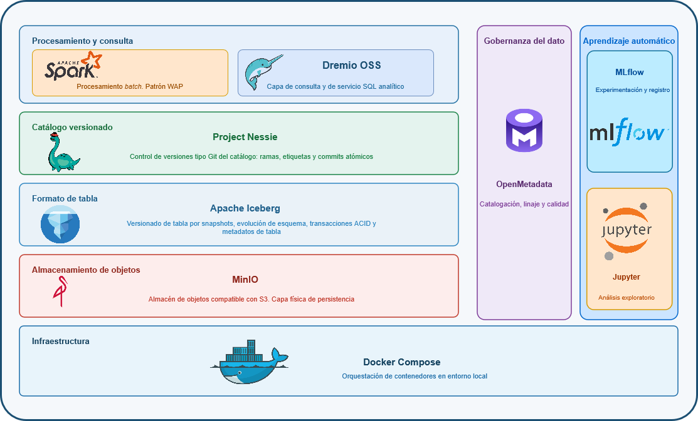
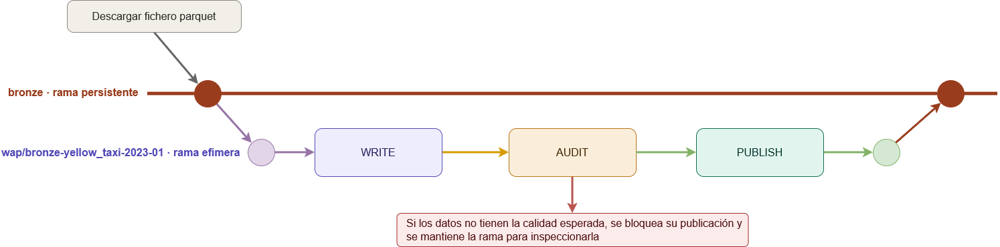
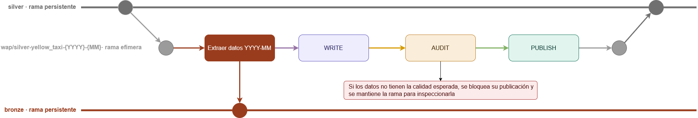
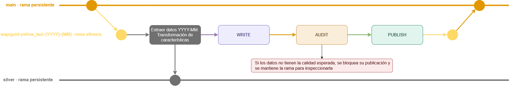
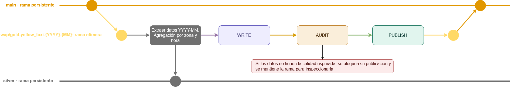

# Diseño e implementación de una arquitectura Data Lakehouse para el ciclo de vida del dato: ingeniería, aprendizaje automático y gobernanza

**Autor:** Jesús Galán Llano · **Director:** Agustín Carlos Caminero Herraez

Trabajo de Fin de Máster del Máster Universitario en Ingeniería y Ciencia de Datos.
Universidad Nacional de Educación a Distancia (UNED).

Implementación de una arquitectura **data lakehouse** construida íntegramente con componentes
de código abierto y desplegada en local mediante contenedores. Cubre tres dimensiones del ciclo de
vida del dato, **ingeniería**, **aprendizaje automático** y **gobernanza**. Emplea los registros
de viajes de taxi amarillo de la New York City Taxi and Limousine Commission (NYC TLC).

Los datos se organizan en capas siguiendo la **arquitectura de medallón**, y su promoción entre
ellas se gobierna con el patrón **Write-Audit-Publish (WAP)** implementado sobre las ramas de un
catálogo versionado. Sobre la capa final se entrenan tres modelos de regresión cuyo ciclo de vida
se gestiona con seguimiento de experimentos, registro versionado y exposición mediante API REST.
Tanto las tablas como los modelos se catalogan en un plano de gobernanza con linaje declarado.

**Stack:** MinIO · Apache Iceberg · Project Nessie · Apache Spark · Dremio OSS · MLflow ·
OpenMetadata · Jupyter Notebook, Docker Compose.

---

## Contenido

1. [Datos: NYC TLC](#1-datos-nyc-tlc)
2. [Arquitectura](#2-arquitectura)
3. [Ingeniería del dato: medallón y WAP](#3-ingeniería-del-dato-medallón-y-wap)
4. [Resultados de la ejecución](#4-resultados-de-la-ejecución)
5. [Consultas versionadas](#5-consultas-versionadas)
6. [Aprendizaje automático](#6-aprendizaje-automático)
7. [Gobernanza](#7-gobernanza)
8. [Puesta en marcha](#8-puesta-en-marcha)
9. [Licencia](#9-licencia)
10. [Cómo citar](#10-cómo-citar)

---

## 1. Datos: NYC TLC

Del programa *Trip Record Data* de la NYC TLC se emplean únicamente los registros del **taxi
amarillo**, publicados en ficheros Parquet mensuales.

| Activo                            | Naturaleza         | Contenido                                                                                                  |
| --------------------------------- | ------------------ | ---------------------------------------------------------------------------------------------------------- |
| `yellow_tripdata_YYYY-MM.parquet` | Tabla de hechos    | Un viaje por fila: proveedor, marcas temporales, descripción del viaje, localización y variables económicas |
| `taxi_zone_lookup.csv`            | Tabla de dimensión | 265 zonas (`LocationID`, `Borough`, `Zone`, `service_zone`)                                                 |

Cuatro campos son **códigos categóricos con dominio cerrado** documentado (`VendorID`,
`RatecodeID`, `payment_type` y `store_and_fwd_flag`), lo que permite validarlos frente a un
conjunto de valores admisibles.

La ingesta se restringe al **primer trimestre de 2023, 2024 y 2025** (nueve ficheros mensuales).
Esa ventana cubre los cambios de esquema recientes de la fuente —entre ellos la aparición de
`cbd_congestion_fee` en enero de 2025—, mantiene un volumen manejable y es estacionalmente
comparable entre años.

El análisis exploratorio previo a la ingesta está en
[bronze/explore.ipynb](src/notebooks/bronze/explore.ipynb) (pandas sobre el Parquet original, sin
Spark ni Nessie), y el análisis sobre el conjunto ya ingerido, que fundamenta las reglas de
limpieza, en [bronze/preprocess.ipynb](src/notebooks/bronze/preprocess.ipynb).

---

## 2. Arquitectura

El principio que define el paradigma lakehouse es la **separación entre almacenamiento y cómputo**,
mediada por un formato de tabla abierto que aporta semántica transaccional. El sistema es, por
tanto, una composición de capas desacopladas en la que cada responsabilidad recae sobre un
componente especializado.



| Componente         | Papel en la arquitectura                                                                 | Versión    |
| ------------------ | ---------------------------------------------------------------------------------------- | ---------- |
| **MinIO**          | Almacenamiento de objetos compatible con S3 (modo *path-style*)                          | 2025-04-22 |
| **Apache Iceberg** | Formato de tabla abierto: ACID por *snapshot*, particionado oculto, evolución de esquema  | 1.10.1     |
| **Project Nessie** | Catálogo versionado tipo Git (ramas y etiquetas); *version store* RocksDB embebido        | 0.106.0    |
| **Apache Spark**   | Cómputo distribuido de los procesos de datos y del entrenamiento (MLlib)                 | 3.5.8      |
| **Dremio OSS**     | Motor de consulta SQL federada sobre las mismas tablas físicas                            | 25.2.0     |
| **MLflow**         | Seguimiento de experimentos, registro de modelos y servicio de inferencia                 | 2.22.1     |
| **OpenMetadata**   | Catálogo de gobernanza: inventario, descubrimiento y linaje                               | 1.12.1     |
| **Elasticsearch**  | Índice de búsqueda de OpenMetadata                                                        | 9.3.0      |
| **PostgreSQL**     | Metadatos de MLflow y de OpenMetadata (instancias separadas)                               | 16         |

### 2.1. Perfiles de despliegue

Los servicios se agrupan en **perfiles**, de modo que cada fase levanta solo el subconjunto que
necesita. El núcleo (almacenamiento y catálogo) se levanta siempre. Los perfiles no son excluyentes
y se pueden combinar.

| Perfil       | Servicios que activa (además del núcleo)                       | Mem. límite | CPU lím. |
| ------------ | -------------------------------------------------------------- | ----------- | -------- |
| núcleo       | `minio`, `nessie` (con sus contenedores de inicialización)      | 1,4 GiB     | 2,5      |
| `ingest`     | `spark-master`, dos `spark-worker`, `spark-notebook`, `dremio`  | 15,4 GiB    | 16,5     |
| `ml`         | los de `ingest`, más `mlflow` y `mlflow-postgres`               | 16,2 GiB    | 18,0     |
| `governance` | `mlflow`, `mlflow-postgres` y los cuatro de OpenMetadata        | 6,9 GiB     | 7,0      |
| `api`        | `mlflow`, `mlflow-postgres`, `model-server`                     | 5,2 GiB     | 5,5      |

El entorno de referencia es una **máquina virtual WSL2 con 13 GiB de memoria, 16 procesadores
lógicos y 3 GiB de espacio de intercambio**.

Cada servicio persistente declara su propio *healthcheck*, y tres contenedores efímeros preparan el
estado inicial antes de que arranquen los servicios que dependen de ellos: `minio-init` crea los
buckets, `nessie-init` ajusta el propietario del volumen del catálogo (Nessie se ejecuta como
usuario no *root*) y `openmetadata-migrate` aplica las migraciones de esquema.

### 2.2. Organización del almacenamiento

| Bucket             | Contenido                                         | Versionado de objetos |
| ------------------ | ------------------------------------------------- | --------------------- |
| `warehouse`        | Todas las tablas de datos del dominio             | No                    |
| `mlflow-artifacts` | Modelos serializados, una carpeta por experimento | Sí                    |
| `spark-logs`       | Registros de eventos de Spark (prefijo `events/`) | No                    |

Los datos del dominio ya se versionan con los *snapshots* de Iceberg y con el catálogo
de Nessie. El versionado de objetos se reserva a los artefactos de modelos. Dentro de
`warehouse` la jerarquía es **capa antes que dominio**:

```
s3a://warehouse/{capa}/{dominio}/{tabla}      →   s3a://warehouse/silver/nyc/yellow_taxi
```

### 2.3. Notas de configuración

- **Spark** funciona en modo *standalone* con dos nodos de trabajo de 5 núcleos y 3 GiB cada uno:
  10 núcleos y unos 6 GiB de memoria de ejecutor en total, con
  `spark.sql.shuffle.partitions = 20`. La configuración está en
  [config/spark/spark-defaults.conf](config/spark/spark-defaults.conf), e Iceberg accede al
  almacenamiento con `HadoopFileIO`.
- **Nessie sirve dos versiones de su API a la vez:** Spark se conecta a `/api/v1`, que es la que
  exigen las `nessie-spark-extensions` 0.106.0; Dremio y el resto de consumidores, a `/api/v2`.
- Las **imágenes de cómputo** salen de un único Dockerfile con tres destinos: `base` (nodos de
  trabajo), `app` (*driver* y servidor de modelos) y `notebook`, de forma que los cuatro
  contenedores comparten los mismos conectores y versiones.
- El alta de Nessie como fuente de datos en **Dremio se hace a mano desde su interfaz** tras el
  primer arranque: es el único paso que queda fuera del despliegue automatizado.

---

## 3. Ingeniería del dato: medallón y WAP

### 3.1. Capas

| Capa       | Cometido                                   | Contrato de datos                                                                                                       |
| ---------- | ------------------------------------------ | ----------------------------------------------------------------------------------------------------------------------- |
| **Bronze** | Representación fiel del origen             | Todas las columnas admiten nulos. Solo se reconcilia la deriva de esquema proyectando sobre un esquema canónico: no se descarta ni se modifica ningún valor |
| **Silver** | Datos depurados y conformados              | Se declaran obligatorias, columna a columna, las que cada regla de limpieza garantiza                                    |
| **Gold**   | Datos agregados y modelados para su consumo | El contrato más estricto: son obligatorias todas las columnas que garantizan las claves, las derivaciones y la auditoría |

Gold no produce una tabla única, sino un producto de datos por caso de uso:

| Tabla                     | Granularidad            | Sirve a                            |
| ------------------------- | ----------------------- | ---------------------------------- |
| `yellow_taxi_trips`       | Viaje individual        | Predicción de tarifa y de duración |
| `pickup_demand_zone_hour` | Zona de recogida × hora | Predicción de demanda              |

### 3.2. La capa es la rama

Todas las tablas comparten un único *namespace* lógico, `nyc`, que identifica el dominio. **La capa
no aparece en el nombre de la tabla, sino en la rama de Nessie donde reside**, así que un mismo
identificador apunta a una tabla física distinta según la referencia activa de la sesión.

| Rama     | Identificador de tabla                 | Descripción                                                             |
| -------- | -------------------------------------- | ----------------------------------------------------------------------- |
| `bronze` | `nessie.nyc.yellow_taxi`               | Ingesta fiel al origen, particionada por `months(tpep_pickup_datetime)` |
| `bronze` | `nessie.nyc.taxi_zone_lookup`          | Referencia, sin particionar (265 filas)                                 |
| `silver` | `nessie.nyc.yellow_taxi`               | Transformación                                                   |
| `silver` | `nessie.nyc.taxi_zone_lookup`          | Nombres de zona normalizados                                            |
| `main`   | `nessie.nyc.yellow_taxi_trips`         | Nivel viaje: zonas desnormalizadas y atributos temporales               |
| `main`   | `nessie.nyc.pickup_demand_zone_hour`   | Agregado por `(pu_location_id, hour_bucket)`                            |

- Cada tabla se crea con un `LOCATION` explícito (`s3a://warehouse/{capa}/nyc/{tabla}`). Sin él,
  el *namespace* compartido dejaría todas las capas sobre la misma ruta.
- **No hay rama `gold`:** la capa final se publica en `main`, que es la rama por defecto del
  catálogo y la que leen los demás componentes.
- Una sesión de Spark está ligada a una sola referencia (`USE REFERENCE`), así que leer de una capa
  y escribir en otra obliga a cambiar de referencia de forma explícita y a traer a memoria los
  datos necesarios. Toda la gestión de referencias pasa por
  [src/common/nessie_manager.py](src/common/nessie_manager.py).

### 3.3. El ciclo WAP

La unidad de trabajo es el par **tabla-mes**, y su promoción sigue cuatro fases iguales en las tres
capas:

1. **Rama efímera** `wap/{capa}-{tabla}-{YYYY}-{MM}`, creada desde la referencia de destino. Lo que
   se escriba en ella es invisible para las sesiones que trabajan sobre las ramas persistentes.
2. **Write:** se materializa sobre esa rama el resultado de la transformación.
3. **Audit:** se evalúa el resultado contra las reglas de calidad de la capa.
4. **Publish:** solo si la auditoría es favorable, la rama se fusiona en el destino y se elimina.

| Transición | Ramifica desde | Lee de             | Publica en |
| ---------- | -------------- | ------------------ | ---------- |
| Bronze     | `bronze`       | ficheros de origen | `bronze`   |
| Silver     | `silver`       | `bronze`           | `silver`   |
| Gold       | `main`         | `silver`           | `main`     |

En bronze la rama efímera nace de `bronze` y su única entrada es el fichero Parquet descargado del
origen:



En silver la rama nace de `silver` pero los datos se leen de `bronze`, de modo que el ciclo cruza
dos ramas persistentes:



En gold sucede lo mismo entre `silver` y `main`. Lo único que distingue a los dos productos de
datos es el paso de transformación: desnormalización de zonas y atributos temporales en el caso de
los viajes, agregación por zona y hora en el de la demanda.





Al apoyarse en ramas del catálogo, la unidad de publicación puede ser un conjunto de tablas: en
gold, una misma rama efímera confirma los dos productos de datos de forma atómica.

### 3.4. Auditoría y cuarentena

| Capa   | Regla de auditoría                                                                                                                                                                     |
| ------ | ---------------------------------------------------------------------------------------------------------------------------------------------------------------------------------------- |
| Bronze | La diferencia de filas antes y después del *append* debe coincidir con las que declara el Parquet de origen. Además, no puede faltar ninguna columna del esquema canónico y se tolera exactamente una nueva |
| Silver | El porcentaje de registros descartados no puede superar el **30 %**                                                                                                                     |
| Gold   | *Viajes:* mismo número de filas que silver y ninguna zona nula. *Demanda:* la suma de `n_pickups` debe coincidir con el número de viajes de origen                                      |

El comportamiento ante un fallo depende de la capa:

- En **silver y gold** la validación **no bloquea**: el resultado se congela en una etiqueta de
  cuarentena `review/{capa}-{tabla}-{YYYY}-{MM}`, la rama efímera se elimina, el fallo se acumula
  en un informe final y el proceso sigue con el mes siguiente.
- En **bronze** la validación **bloquea**: lanza una excepción y conserva la rama efímera para
  poder inspeccionarla, porque una discrepancia con lo que declara el origen apunta a un fallo del
  propio mecanismo de ingesta.

Al fusionar el último mes de cada año se crea una **etiqueta de auditoría anual**
`{capa}-{tabla}-{YYYY}`, que fija un punto inmutable del estado de la capa al cierre de ese año.

### 3.5. Reglas de limpieza de silver

[clean_yellow_taxi.py](src/pipelines/silver/clean_yellow_taxi.py) aplica dos etapas en este orden:

1. **Filtrado de validez:** descarta los registros erróneos según el diccionario de la TLC, es
   decir, marcas temporales ausentes o incoherentes, importes no positivos, distancias o cargos
   negativos, identificadores de zona fuera de rango, códigos categóricos ajenos al dominio
   documentado y duplicados exactos.
2. **Eliminación de valores atípicos** con el criterio de Tukey en su variante *far out* (k = 3),
   que recorta ambas colas de la tarifa, el importe total, la distancia y la duración.

Los límites se calculan sobre los datos ya validados, **por separado para cada `RatecodeID`** —cada
código tarifario es una población distinta, y un límite único descartaría como atípicos los viajes
de tarifa plana de aeropuerto— y con el agregado exacto `percentile`, no con su aproximación, que
depende del reparto de los datos entre particiones.

---

## 4. Resultados de la ejecución

Nueve ficheros mensuales y una tabla de referencia, consolidados por capa:

| Capa   | Tabla                     | Registros  | Columnas                 | Ficheros Parquet |
| ------ | ------------------------- | ---------- | ------------------------ | ---------------- |
| bronze | `yellow_taxi`             | 30.137.291 | 20                       | 9                |
| bronze | `taxi_zone_lookup`        | 265        | 4                        | 1                |
| silver | `yellow_taxi`             | 24.393.325 | 20 (14 obligatorias)     | 9 · 373,21 MB    |
| silver | `taxi_zone_lookup`        | 265        | 4 (3 obligatorias)       | 1                |
| main   | `yellow_taxi_trips`       | 24.393.325 | 32 (24 obligatorias)     | 9 · 458,4 MiB    |
| main   | `pickup_demand_zone_hour` | 631.388    | 16 (15 obligatorias)     | 9                |

**Evolución de esquema.** Los nueve ficheros de origen presentan tres tipos de modificaciones: cambios de
tipo (`int64` → `int32`, `double` → `int64`), cambio de nombre (`airport_fee` → `Airport_fee`) y
**una columna nueva**, `cbd_congestion_fee`, a partir de enero de 2025. La ingesta resuelve los dos
primeros proyectando sobre el esquema canónico, y el tercero con `ALTER TABLE ADD COLUMNS` cuando
detecta el campo por primera vez. Los **18.939.265** nulos de `cbd_congestion_fee` coinciden con el
total acumulado en la etiqueta `bronze-yellow_taxi-2024`, es decir, con todos los registros
anteriores a la aparición de la columna.

**Retención tras la depuración**, acumulada por año:

| Etiqueta                  | Bronze acumulado | Silver acumulado | Retención (%) |
| ------------------------- | ---------------- | ---------------- | ------------- |
| `silver-yellow_taxi-2023` | 9.384.348        | 8.323.718        | 88,70         |
| `silver-yellow_taxi-2024` | 18.939.105       | 16.313.253       | 86,14         |
| `silver-yellow_taxi-2025` | 30.137.106       | 24.393.325       | 80,94         |

El descarte crece de forma sostenida, del 11,01 % en enero de 2023 al 29,89 % en marzo de 2025.
Como las reglas son las mismas en los nueve meses, la causa está en los datos de entrada: los
ficheros de 2025 incluyen un bloque de viajes sin `passenger_count`, `RatecodeID` ni
`store_and_fwd_flag`.

El crecimiento acumulado de la tabla gold de viajes coincide cifra por cifra con el de silver en
las tres etiquetas, tal como exige la auditoría. El agregado de demanda resume esos 24.393.325
viajes en 631.388 grupos, con una media de 38,63 recogidas por grupo, y su perfil horario reproduce
la forma esperada: valle nocturno, meseta al mediodía y máximo por la tarde.

---

## 5. Consultas versionadas

Conviven **dos planos de versionado**: el de la **tabla**, que Iceberg materializa con *snapshots*,
y el del **catálogo**, que Nessie superpone con ramas y etiquetas y que añade el aislamiento entre
estados concurrentes y la reconstrucción de un estado histórico común a todas las tablas.

Tras la ejecución completa, `LIST REFERENCES` devuelve **diecisiete referencias**: las tres ramas
persistentes (`main`, `bronze` y `silver`) y catorce etiquetas de auditoría anual. No queda ninguna
rama `wap/` —todas se fusionaron y se eliminaron— ni ninguna etiqueta `review/`, así que ningún mes
quedó en cuarentena.

**Aislamiento por ramas.** Con la sesión situada en `bronze`, `nessie.nyc.yellow_taxi` devuelve
30.137.291 registros; con la sesión en `silver`, el mismo identificador devuelve 24.393.325. Al ser
idéntico en varias ramas, una lectura sobre la referencia equivocada no da error, sino un resultado
incorrecto. Solo falla cuando la tabla no existe en la referencia activa.

Spark fija la referencia **por sesión** (`USE REFERENCE <ref> IN nessie`) y Dremio la cualifica
**por sentencia**:

```sql
-- Aislamiento por ramas: el mismo identificador, dos capas
SELECT COUNT(*) FROM nessie.nyc.yellow_taxi AT BRANCH "bronze";   -- 30.137.291
SELECT COUNT(*) FROM nessie.nyc.yellow_taxi AT BRANCH "silver";   -- 24.393.325

-- Dos estados históricos en una sola sentencia: los registros añadidos en 2025
SELECT
  (SELECT COUNT(*) FROM nessie.nyc.yellow_taxi AT TAG "silver-yellow_taxi-2025")
  - (SELECT COUNT(*) FROM nessie.nyc.yellow_taxi AT TAG "silver-yellow_taxi-2024")
  AS registros_de_2025;
```

Cada modelo registrado guarda dos referencias del estado de los datos en el momento de entrenarlo:
el **hash del commit de `main`** (`nessie_main_hash`), que fija el catálogo completo, y el
**identificador del último *snapshot*** de la tabla gold de origen (`source_snapshot_id`), que fija
esa tabla concreta. Con ambas se puede reconstruir el conjunto de entrenamiento aunque gold haya
seguido creciendo.

---

## 6. Aprendizaje automático

El código de ML consume **solo las tablas gold publicadas en `main`**. Los módulos compartidos están
en [src/ml/](src/ml/): [splits.py](src/ml/splits.py) (preparación de los datos),
[pipelines.py](src/ml/pipelines.py) (construcción del *pipeline* de Spark ML),
[algorithms.py](src/ml/algorithms.py) (algoritmos e hiperparámetros) y
[tracking.py](src/ml/tracking.py) (sesión, evaluadores, validación cruzada y registro).

### 6.1. Casos de uso

| Caso       | Variable objetivo       | Tabla de origen                      | GLR: familia / enlace | Modelo registrado |
| ---------- | ----------------------- | ------------------------------------ | --------------------- | ----------------- |
| `fare`     | `fare_amount`           | `nessie.nyc.yellow_taxi_trips`       | gamma / log           | `fare_prediction` |
| `duration` | `trip_duration_minutes` | `nessie.nyc.yellow_taxi_trips`       | gamma / log           | `trip_duration_prediction` |
| `demand`   | `n_pickups`             | `nessie.nyc.pickup_demand_zone_hour` | poisson / log         | `demand_forecast` |

Los tres comparten un único proceso de entrenamiento, que recibe el caso de uso como argumento. Lo
que los distingue es una especificación declarativa, el diccionario `USE_CASES` de
[train.py](src/ml/train.py), donde se fijan la tabla de origen, la variable objetivo, los
predictores y la familia de la regresión lineal generalizada.

```bash
docker exec -it spark-master spark-submit /opt/spark/src/ml/train.py fare    # duration | demand
docker exec -it spark-master spark-submit /opt/spark/src/ml/train.py fare --fast   # ejecución reducida de verificación
```

Se comparan tres algoritmos de Spark MLlib: **`GeneralizedLinearRegression`** (paramétrico e
interpretable), **`GBTRegressor`** (árboles con *boosting*, reduce el sesgo) y
**`RandomForestRegressor`** (árboles con *bagging*, reduce la varianza).

### 6.2. Preparación de los datos

- **Reparto de los subconjuntos.** El conjunto de **test son todos los viajes de 2025**, que no
  intervienen ni en el entrenamiento ni en la elección del modelo. Entrenamiento y validación
  salen de 2023 y 2024 mediante un reparto aleatorio estratificado por año, con el 15 % para
  validación. **Todos los candidatos se entrenan sobre ese mismo conjunto**, de modo que la
  comparación entre ellos aísla el algoritmo y sus hiperparámetros.
- **Uso de las métricas.** La validación es el único subconjunto que interviene en las decisiones,
  tanto en el ajuste de hiperparámetros como en la elección entre algoritmos. Las métricas de
  prueba se calculan solo al final, para documentar el rendimiento esperado ante datos nuevos.
- **Variables descartadas.** Se eliminan las categóricas redundantes (distrito y zona de servicio
  se derivan del identificador de zona) y el año, que actúa como clave de reparto y no como
  predictor.
- **Codificación cíclica.** Hora, día de la semana y semana se transforman en pares seno/coseno
  para los modelos lineales, y se mantienen como enteros para los modelos de árboles.

### 6.3. Experimentación

No hay modelos con hiperparámetros por defecto: cada algoritmo entra directamente en el **ajuste de
hiperparámetros**, explorado sobre cuatro configuraciones con validación cruzada de tres particiones
calculada solo sobre el entrenamiento, es decir, doce ajustes por algoritmo, lanzados de dos en dos
sobre los dos ejecutores. Gana el de menor error de validación, que se reentrena sobre todo el
conjunto de entrenamiento con esa configuración. El resultado es un candidato por algoritmo, los
tres entrenados con los mismos años y evaluados sobre los mismos subconjuntos.

### 6.4. Registro y promoción

Cada ejecución registra **tres candidatos** —uno por algoritmo, ya optimizado— como versiones nuevas
del modelo registrado, con sus métricas sobre los tres subconjuntos, sus hiperparámetros y su
procedencia.

Dos alias marcan roles de despliegue: **`@champion`** es la versión que se sirve, y **`@previous`**
aquella a la que se revertiría, es decir, la que el campeón vigente relevó. El mejor candidato de la
ejecución sustituye al campeón solo si su error de validación es estrictamente menor; al hacerlo, el
destronado pasa a `@previous`. Si no lo mejora, ningún alias se mueve y la versión queda registrada
como candidata. Al terminar se conservan las **veinte versiones más recientes** y todas las que tengan alias
—lo que garantiza que el punto de reversión nunca se elimina—, y el resto se descarta.

En cada versión, el atributo `validation_status` refleja su situación: `champion`, `previous` o
`candidate`.

Al promocionar, el nuevo `@champion` recibe además una medición de **latencia de inferencia** sobre
1000 filas de prueba, útil para comparar el coste entre campeones sucesivos.

Hay un notebook de diagnóstico por caso de uso
([fare](src/notebooks/ml/fare_diagnostics.ipynb) ·
[duration](src/notebooks/ml/duration_diagnostics.ipynb) ·
[demand](src/notebooks/ml/demand_diagnostics.ipynb)): carga el `@champion`, reconstruye los
subconjuntos con la misma semilla, mide el modelo en cada uno y muestra predicho frente a real,
residuos e importancia de los predictores. **No reentrena.**

### 6.5. Servicio del modelo (API REST)

El servicio `model-server` (perfil `api`) ejecuta el servidor de inferencia de MLflow sobre una
referencia del registro. El modelo y el alias se configuran en `.env` (`SERVE_MODEL` y
`SERVE_ALIAS`; por defecto, `fare_prediction` y `champion`). Como resuelve esa referencia al
arrancar, necesita que ya exista una versión con ese alias, por lo que no se puede levantar antes
del entrenamiento.

```bash
docker compose --profile api up -d model-server

curl -s -X POST http://localhost:5001/invocations \
  -H 'Content-Type: application/json' -d @src/ml/api/examples/fare_request.json

python src/ml/api/client.py fare
```

| Método | Ruta           | Propósito                                        |
| ------ | -------------- | ------------------------------------------------ |
| GET    | `/ping`        | Disponibilidad (200 cuando el modelo ha cargado) |
| GET    | `/health`      | Igual que `/ping`                                |
| GET    | `/version`     | Versión de MLflow del servidor                   |
| POST   | `/invocations` | Devuelve las predicciones de un lote de filas    |

El cuerpo de la petición es un `dataframe_split` con los predictores de gold del caso de uso, sin
las categóricas redundantes ni el año. Hay ejemplos por caso de uso en
[src/ml/api/examples/](src/ml/api/examples/): llevan hora, día de la semana y semana como enteros,
por lo que sirven para un campeón basado en árboles; uno lineal necesitaría además las componentes
seno/coseno.

---

## 7. Gobernanza

**Cobertura.** El catálogo recoge dos tipos de activo: las tablas del *namespace* `nyc`, tal como
las expone Nessie por su *endpoint* Iceberg-REST, y los modelos registrados en MLflow.

Ese *endpoint* selecciona la rama mediante el **prefijo** de la petición REST, un campo que el
conector de la edición de código abierto no expone. La imagen de ingesta
([docker/om-ingestion/](docker/om-ingestion/)) lo parchea para poder inyectarlo desde una variable
de entorno, y [run_ingestion.sh](config/openmetadata/run_ingestion.sh) ejecuta **una invocación por
rama**, de forma que cada capa se cataloga como un servicio propio:

| Servicio en OpenMetadata | Rama de Nessie | Activos                                               |
| ------------------------ | -------------- | ----------------------------------------------------- |
| `iceberg_bronze`         | `bronze`       | `yellow_taxi`, `taxi_zone_lookup`                     |
| `iceberg_silver`         | `silver`       | `yellow_taxi`, `taxi_zone_lookup`                     |
| `iceberg_gold`           | `main`         | `yellow_taxi_trips`, `pickup_demand_zone_hour`        |
| `mlflow_registry`        | —              | `fare_prediction`, `trip_duration_prediction`, `demand_forecast` |

De cada modelo se cataloga la versión **`@champion`**, la que se sirve.

**Linaje.** Los conectores de metadatos no deducen las relaciones entre tablas, así que el grafo se
**declara como código**: [lineage.py](config/openmetadata/lineage.py) publica al final de cada
ingesta el recorrido bronze → silver → gold → modelos, a nivel de tabla y de columna. Las
peticiones son idempotentes, de modo que el grafo se reconstruye entero en cada ejecución.

**Calidad.** Las comprobaciones de calidad son las puertas de auditoría del ciclo WAP, que actúan
sobre los datos candidatos antes de publicarlos. El perfilador y las suites de pruebas de
OpenMetadata, que trabajan sobre datos ya publicados, quedan documentados como extensión disponible
y no se emplean en este sistema.

```bash
# 1. Levantar governance junto con ml (MLflow debe seguir disponible como fuente)
docker compose --profile ml --profile governance up -d

# 2. Construir la imagen de ingesta (una sola vez)
docker build -t datalakehouse/om-ingestion:1.12.1 docker/om-ingestion

# 3. Guardar en .env el JWT del ingestion-bot como OM_INGESTION_BOT_JWT
#    (Settings > Bots > ingestion-bot en la interfaz)

# 4. Ingesta completa: las tres capas Iceberg, los modelos y el grafo de linaje
config/openmetadata/run_ingestion.sh
```

La ingesta y la indexación son pasos independientes: si los activos responden por la API pero no
aparecen en el buscador de la interfaz, lo que ha fallado es la segunda, y basta con volver a
lanzarla desde *Settings → Applications → Search Indexing → Run* o con
`POST /api/v1/apps/trigger/SearchIndexingApplication`, sin repetir la ingesta.

---

## 8. Puesta en marcha

### 8.1. Requisitos

- **Docker**, **Docker Compose** y **Git**.
- **Entorno de referencia:** máquina virtual WSL2 con **13 GiB de memoria, 16 procesadores lógicos
  y 3 GiB de espacio de intercambio** (configurable en `%USERPROFILE%\.wslconfig`: `memory=13GB`,
  `processors=16`, `swap=3GB`).
- Las dependencias de ejecución van dentro de las imágenes, así que **no hay que instalar nada en
  local**. Un entorno virtual de Python solo es útil para el soporte del editor y el *linting*.

### 8.2. Estructura del repositorio

```
datalakehouse/
├── docker-compose.yml          # Orquestación completa (servicios, healthchecks, perfiles)
├── .env / .env.example         # Configuración de entorno (credenciales, modelo a servir…)
├── config/
│   ├── spark/                  # spark-defaults.conf (catálogo y S3/MinIO), log4j2.properties
│   ├── dremio/                 # dremio.conf (fuentes de datos desde la interfaz)
│   ├── nessie/                 # application.properties (catálogo Iceberg-REST integrado)
│   └── openmetadata/           # iceberg_metadata.yaml, mlflow_metadata.yaml,
│                               # run_ingestion.sh, lineage.py
├── docker/
│   ├── spark/Dockerfile        # Imagen con tres destinos (base/app/notebook), Iceberg y Nessie
│   ├── mlflow/Dockerfile       # Servidor de seguimiento de MLflow
│   └── om-ingestion/           # Imagen de ingesta de metadatos (parchea el prefijo Iceberg-REST)
├── docs/img/                   # Figuras referenciadas en este documento
├── src/
│   ├── common/                 # spark_factory.py, nessie_manager.py, iceberg_schema.py
│   ├── pipelines/
│   │   ├── bronze/             # ingest_yellow_taxi.py, ingest_zone_lookup.py
│   │   ├── silver/             # clean_yellow_taxi.py, clean_zone_lookup.py
│   │   └── gold/               # build_yellow_taxi_trips.py, aggregate_demand_zone_hour.py
│   ├── ml/                     # train.py (punto de entrada) y splits/pipelines/algorithms/tracking
│   │   └── api/                # client.py y examples/ (peticiones por caso de uso)
│   └── notebooks/              # bronze/, silver/, gold/ (verificación) y ml/ (diagnósticos)
├── LICENSE                     # GNU GPL v3
└── README.md                   # Este documento
```

### 8.3. Construcción de las imágenes

Los servicios del núcleo son imágenes de terceros y no se construyen, así que el comando debe
incluir todos los perfiles:

```bash
cp .env.example .env    # rellenar las credenciales

docker compose --profile ingest --profile ml --profile governance --profile api build
docker build -t datalakehouse/om-ingestion:1.12.1 docker/om-ingestion
```

La imagen de ingesta de metadatos se construye aparte porque no es un servicio que se levante, sino
una herramienta que se invoca. Dos variables de `.env` no se pueden rellenar todavía: el JWT del
agente de ingesta, que exige el servidor de gobernanza en marcha, y el modelo a servir, cuyo alias
no existe hasta que termina el entrenamiento.

### 8.4. Despliegue por perfiles y endpoints

Levantar un perfil adicional no reemplaza el despliegue anterior, sino que lo amplía.

```bash
docker compose up -d                                    # solo el núcleo (MinIO y Nessie)
docker compose --profile ingest up -d                   # + Spark y Dremio
docker compose --profile ml up -d                       # + MLflow (y su PostgreSQL)
docker compose --profile governance up -d               # + OpenMetadata (PostgreSQL y Elasticsearch)
docker compose --profile api up -d model-server         # + servicio REST del modelo
docker compose --profile ml --profile governance up -d  # los perfiles se combinan

docker compose ps                                       # comprobar el estado de salud
```

| Servicio            | URL                                    | Perfil              |
| ------------------- | -------------------------------------- | ------------------- |
| Consola de MinIO    | `http://localhost:9001`                | núcleo              |
| API S3 de MinIO     | `http://localhost:9000`                | núcleo              |
| API de Nessie (v2)  | `http://localhost:19120/api/v2/config` | núcleo              |
| Spark Master        | `http://localhost:8080`                | `ingest` / `ml`     |
| Jupyter Notebook    | `http://localhost:8888`                | `ingest` / `ml`     |
| Dremio              | `http://localhost:9047`                | `ingest` / `ml`     |
| MLflow              | `http://localhost:5000`                | `ml` / `governance` |
| API REST del modelo | `http://localhost:5001`                | `api`               |
| OpenMetadata        | `http://localhost:8585`                | `governance`        |

### 8.5. Secuencia de ejecución

```bash
# 1. Capas de datos (perfil `ingest`)
docker exec -it spark-master spark-submit /opt/spark/src/pipelines/bronze/ingest_yellow_taxi.py
docker exec -it spark-master spark-submit /opt/spark/src/pipelines/bronze/ingest_zone_lookup.py
docker exec -it spark-master spark-submit /opt/spark/src/pipelines/silver/clean_yellow_taxi.py
docker exec -it spark-master spark-submit /opt/spark/src/pipelines/silver/clean_zone_lookup.py
docker exec -it spark-master spark-submit /opt/spark/src/pipelines/gold/build_yellow_taxi_trips.py
docker exec -it spark-master spark-submit /opt/spark/src/pipelines/gold/aggregate_demand_zone_hour.py

# 2. Entrenamiento (perfil `ml`)
docker exec -it spark-master spark-submit /opt/spark/src/ml/train.py fare
docker exec -it spark-master spark-submit /opt/spark/src/ml/train.py duration
docker exec -it spark-master spark-submit /opt/spark/src/ml/train.py demand

# 3. Servicio REST (perfil `api`, requiere un alias @champion ya registrado)
docker compose --profile api up -d model-server

# 4. Catalogación (perfil `governance`, requiere gold y los modelos ya producidos)
config/openmetadata/run_ingestion.sh
```

Los notebooks se abren desde el servicio de Jupyter (`http://localhost:8888`):
[explore](src/notebooks/bronze/explore.ipynb) →
[verify bronze](src/notebooks/bronze/verify_iceberg.ipynb) →
[preprocess](src/notebooks/bronze/preprocess.ipynb) →
[verify silver](src/notebooks/silver/verify_iceberg.ipynb) →
[verify gold](src/notebooks/gold/verify_iceberg.ipynb) →
[diagnósticos de ML](src/notebooks/ml/).

La corrección se comprueba de extremo a extremo con las puertas de
auditoría del ciclo WAP y con los notebooks `verify_iceberg.ipynb` de cada capa. Al cambiar un
esquema conviene volver a ejecutar el de la capa afectada.

### 8.6. Parada del entorno

```bash
docker compose down       # conserva los volúmenes con nombre
docker compose down -v    # elimina los volúmenes: reinicio real desde cero
```

La primera opción baja el entorno pero mantiene los datos persistentes (datos, historial del catálogo y experimentos e inventario de gobernanza).
La segunda, además, elimina todos los volúmenes persistentes permitiendo volver al estado 
original del sistema.

---

## 9. Licencia

Este proyecto se distribuye bajo la **Licencia Pública General de GNU, versión 3 (GNU GPL v3)**;
el texto completo está en [LICENSE](LICENSE). Es una licencia *copyleft*: garantiza la libertad de
usar, estudiar, compartir y modificar el software, siempre que las obras derivadas se distribuyan
bajo los mismos términos.

---

## 10. Cómo citar

Los metadatos de citación están en [CITATION.cff](CITATION.cff), en formato
[Citation File Format](https://citation-file-format.github.io/)

Referencia en texto (estilo IEEE):

> [1] J. Galán Llano, *Diseño e implementación de una arquitectura Data Lakehouse para el ciclo
> de vida del dato: ingeniería, aprendizaje automático y gobernanza* (versión 1.0.0). (2026).
> Accedido: 12 de agosto de 2026. [En línea]. Disponible en:
> https://github.com/jgalanl/datalakehouse

Entrada BibTeX:

```bibtex
@misc{GalanLlano2026Datalakehouse,
  author       = {Galán Llano, Jesús},
  title        = {Diseño e implementación de una arquitectura Data Lakehouse para el
                  ciclo de vida del dato: ingeniería, aprendizaje automático y gobernanza},
  year         = {2026},
  version      = {1.0.0},
  howpublished = {\url{https://github.com/jgalanl/datalakehouse}},
}
```
